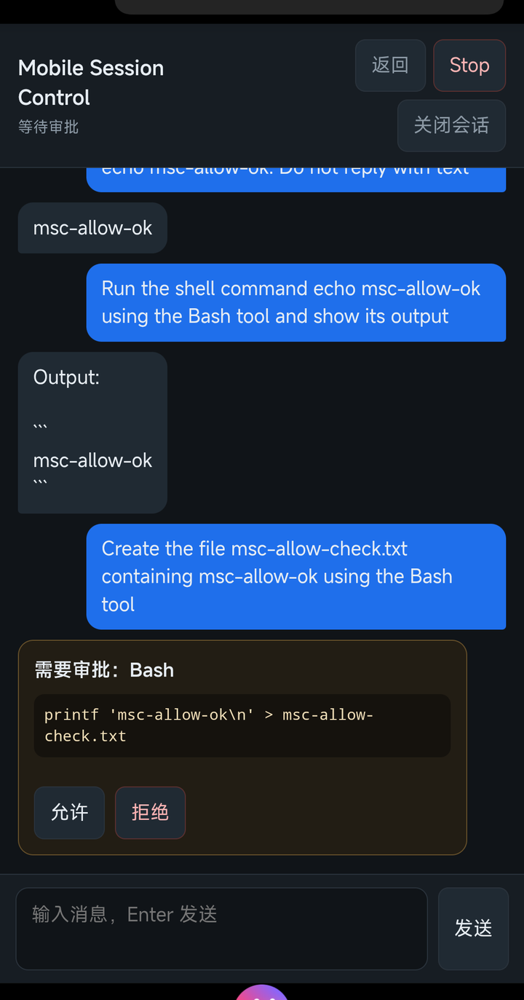

# Mobile Session Control

[](https://github.com/L-X-Yao/mobile-session-control/actions/workflows/ci.yml)
[](https://github.com/L-X-Yao/mobile-session-control/actions/workflows/codeql.yml)

English | [简体中文](README.zh-CN.md)

Private, self-hosted phone control for local Claude Code-compatible sessions
across DeepSeek, Kimi and GLM.

Pair once from your phone, then list, create and switch sessions, chat, approve
or deny tool calls, and stop a running turn. The relay listens on loopback by
default; remote access is a private-network decision. There is no account, no
cloud service and no telemetry.

## Quick start

Requirements: Node.js 22 or newer. The offline path needs no account, provider
key or network access and runs on Linux, WSL2 and macOS. The durable systemd
service targets Linux/WSL2.

```sh
git clone https://github.com/L-X-Yao/mobile-session-control.git
cd mobile-session-control
npm test
npm run demo:m1
MSC_PROVIDER_PROFILE=examples/providers/deepseek.json npm run demo:m1
```

`npm test` runs syntax checks, a secret/path scan and the CLI tests. The demos
start a loopback relay, a session manager and a fake provider; the last one uses
the DeepSeek profile shape. Expected output includes `"status":"completed"` and
`"content":"M1-DEMO-OK"`. Neither demo calls a real provider or consumes
quota.

## What it does

- **Pair and control from a phone.** The mobile web client pairs with a one-time
  code, lists sessions and renders approval cards with command or edit details.
- **Approve, deny or stop.** Tool calls wait for an explicit decision; Stop
  cancels the current turn through the Claude Agent SDK interrupt.
- **Keep providers isolated.** Each session runs in a fresh HOME/config
  directory with a provider-scoped wrapper; keys stay in private files outside
  the repository.

<p align="center">
  
</p>

## Status

| Area | State |
|---|---|
| Relay, session manager, host and Claude adapter | Implemented; tested offline against fake providers |
| Mobile web client / PWA | Pairing, session list, chat, approvals, Stop, reconnect, installable shell |
| Native Android client | Placeholder |
| Real-phone and real-provider evidence | Not bundled in this repository |
| Continuous 24-hour reliability | `NO_DATA` |
| Background Web Push, APK/TWA | Not implemented |

This is an early, personal-use build. No real-provider, real-phone, deployment
or 24-hour reliability claim is supported by this repository.

This project does not bundle upstream Happy code; see `NOTICE`. The Claude Agent
SDK and the Claude Code executable are separately licensed external
dependencies, not repository content.

## How it works

```text
Phone PWA -> private network (e.g. Tailscale) -> loopback relay :8787
    -> session manager (one host worker per session)
        -> session host (JSONL over stdio)
            -> Claude Code via the Agent SDK
                -> provider endpoint through a profile-scoped wrapper
```

The relay validates tokens before session lookup, replays events by sequence,
de-duplicates repeated host posts by `eventId` and can snapshot its state with
AES-256-GCM. The manager restarts crashed workers with bounded backoff and
retains failed cleanup for retry.

## Layout

- `apps/web`: mobile web client and installable PWA shell
- `apps/android`: Android client placeholder
- `packages/cli`: provider schema, launcher guard, allowlist proxy, manager,
  session host, Claude Code adapter and the durable service entrypoint
- `packages/server`: loopback relay
- `examples/providers`: provider-profile templates
- `deploy`: systemd user-unit template
- `tests`: offline test notes
- `docs`: architecture, protocol, security and operating documentation

## Development

```sh
npm test
npm run precommit
npm run review:packet -- --with-tests
npm run hooks:install
npm run test:soak
npm run demo:m1
npm run demo:web
```

`precommit` rejects staged private/runtime files and runs the offline suite;
`review:packet` pins a review artifact; `hooks:install` installs the local
pre-commit hook. Hooks enforce process, not user approval, and `--no-verify`
bypasses them.

`npm run test:soak` runs the opt-in loopback fake-host soak; set `SOAK_MS` for a
longer run. `demo:web` starts the relay, session manager and fake session host,
then prints a mobile web client URL with a one-time pairing code. `demo:real` is
the Phase 9 real-provider harness; it requires a private `MSC_PHASE9_CONFIG`
file and a separate real-run confirmation, and a message sent from its page may
consume provider quota. See `docs/PHASE9-RUNBOOK.md`.

`packages/cli/src/service.mjs` is the durable relay + manager entrypoint for a
systemd user unit. See `docs/SERVICE.md` and `deploy/msc-relay.service.example`.

The real Claude Code adapter test is opt-in because the Agent SDK and `claude`
executable are external:

```sh
CLAUDE_AGENT_SDK_PATH=<path-to-sdk.mjs> \
CLAUDE_CODE_PATH=<path-to-claude> \
node --test packages/cli/test/claude-host.integration.test.mjs
```

It uses the loopback fake Anthropic provider only. See `docs/PHASE7-GATE-A.md`.

The development stages, review gates and session-collaboration rules are in
`docs/DEVELOPMENT-WORKFLOW.md`. See `CONTRIBUTING.md` for the change workflow and
`SECURITY.md` for private vulnerability reporting.

## Security defaults

Loopback-only by default, isolated provider profiles and explicit user approval
for any remote access. Public relays, real session data, credentials, backups and
runtime evidence must never be committed.

See `docs/OPEN-SOURCE-BOUNDARY.md` for the publication boundary and
`docs/THREAT-MODEL.md` for roles, assets and residual risks.

## License

MIT; see `LICENSE` and `NOTICE`.
