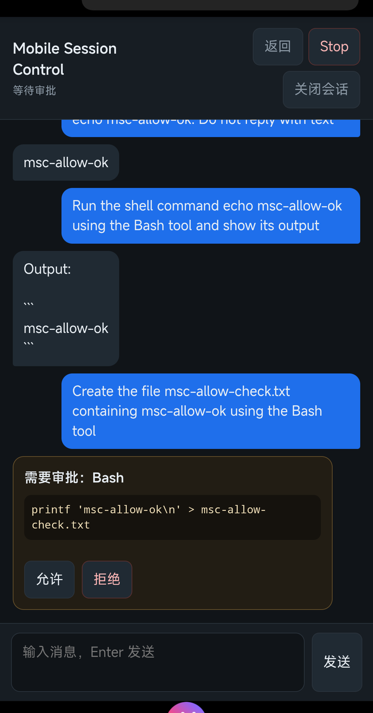

# Mobile Session Control

[](https://github.com/L-X-Yao/mobile-session-control/actions/workflows/ci.yml)

[English](README.md) | 简体中文

中文版可能滞后，内容以英文版为准。

私有、自托管的手机控制层，用来操作本机多个 Claude Code 兼容会话
（DeepSeek / Kimi / GLM）。

手机配对一次后，可以新建、切换、关闭会话，聊天，审批或拒绝工具调用，并停止
正在执行的轮次。中继默认只监听环回地址，远程访问属于私网决策。无账号、无云服务、
无遥测。

## 快速开始

要求 Node.js 22 或更新版本。离线路径不需要账号、provider key 或网络。

```sh
git clone https://github.com/L-X-Yao/mobile-session-control.git
cd mobile-session-control
npm test
npm run demo:m1
MSC_PROVIDER_PROFILE=examples/providers/deepseek.json npm run demo:m1
```

`npm test` 执行语法检查、密钥/路径扫描和 CLI 测试。两个 demo 都只启动环回中继、
会话管理器和 fake provider；最后一条使用 DeepSeek 的 profile 形态。预期输出包含
`"status":"completed"` 和 `"content":"M1-DEMO-OK"`，不会调用真实 provider，也不消耗配额。

<p align="center">
  
</p>

## 状态

| 区域 | 状态 |
|---|---|
| 中继、会话管理器、host、Claude 适配器 | 已实现，离线 fake provider 测试通过 |
| 手机 Web 客户端 / PWA | 配对、会话列表、聊天、审批、Stop、重连、可安装 |
| 原生 Android 客户端 | 占位 |
| 真机与真实 provider 证据 | 不在本仓库内 |
| 连续 24 小时可靠性 | `NO_DATA` |
| 后台 Web Push、APK/TWA | 未实现 |

这是早期个人自用版本。本仓库不支持真实 provider、真机、部署或 24 小时可靠性的
结论性声明。

本项目不捆绑上游 Happy 代码，见 `NOTICE`。Claude Agent SDK 与 Claude Code
可执行文件是单独许可的外部依赖，不属于本仓库内容。

## 工作方式

```text
手机 PWA -> 私网（如 Tailscale）-> 环回中继 :8787
    -> 会话管理器（每个会话一个 host worker）
        -> session host（stdin/stdout JSONL）
            -> 通过 Agent SDK 调用 Claude Code
                -> 经 profile 包装器访问 provider
```

中继先校验 token 再查会话，按序号重放事件，用 `eventId` 去重，并可用
AES-256-GCM 快照状态。管理器对崩溃 worker 做有界退避重启，清理失败会保留重试。

## 目录

- `apps/web`：手机 Web 客户端与可安装 PWA
- `apps/android`：Android 客户端占位
- `packages/cli`：provider schema、启动参数守卫、allowlist 代理、管理器、
  session host、Claude 适配器与常驻服务入口
- `packages/server`：环回中继
- `examples/providers`：provider profile 模板
- `deploy`：systemd 用户单元模板
- `docs`：架构、协议、安全与运维文档（英文）

## 安全默认

默认只监听环回地址、隔离 provider profile、远程访问需单独批准。公开中继、真实会话
数据、凭据、备份与运行证据不得提交。

## 许可

MIT，见 `LICENSE` 与 `NOTICE`。

完整开发流程、协议与安全模型见英文文档：[架构](docs/ARCHITECTURE.md)、
[威胁模型](docs/THREAT-MODEL.md)、[发布边界](docs/OPEN-SOURCE-BOUNDARY.md)、
[贡献指南](CONTRIBUTING.md)。
